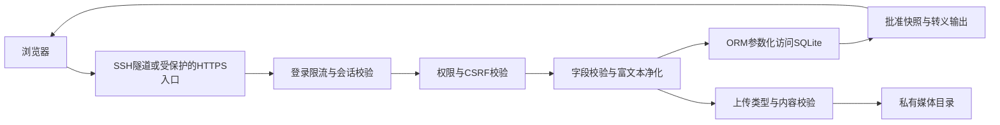

# 安全设计稿（基础防护）

适用：河南大学集成电路与微纳电子学院。更新：2026-10-11。与[前端设计稿](04_前端设计稿.md)独立并列；排期见[实施总计划](03_设计开发实施计划.md)。以下为待实现和待验收的要求，不是已完成安全测试的结论。

今晚由你独立完成初版，优先保护本轮实际开放的功能；尚未实现的登录、上传和学校接入不能显示可用。

## 1 系统边界

浏览器只访问页面和允许公开的资源；演示后台、草稿、媒体预览、SQLite和备份有各自访问限制。自有预览与现有服务器网站使用不同目录、服务名、端口、数据库和应用密钥。正式站群的认证、数据库及账号安全由平台控制，我们检查模板及接入权限，不承诺修改平台内部防护。

自有预览的安全流程：

该图描述编辑与审核路径；对外展示仅能读取明确批准公开的内容。正式站群使用学校自己的认证和发布路径，上图不代替学校安全架构。

## 2 风险与控制

| 风险 | 自有预览系统的设计 | 正式站群需要核实 |
|---|---|---|
| 弱口令、暴力登录 | 密码至少12位，拒绝常见弱口令；失败提示不暴露账号存在性；django-axes按账号与来源限流，连续5次失败锁定15分钟 | 账号策略、登录限制、统一认证要求 |
| 越权发布、草稿泄露 | 编辑/审核/管理员分权；所有写操作服务端校验；预览登录可见，公开页仅读批准快照；草稿媒体也受权限保护 | 编辑审核发布权限和真实工作流 |
| CSRF与会话冒用 | Django CSRF校验；HTTPS入口使用Secure、HttpOnly及SameSite Cookie；不使用默认密钥、不在URL放令牌 | 由站群认证实现；核验官方入口 |
| SQL注入 | Django ORM或参数化查询，不拼接SQL；排序、过滤参数限制在允许项 | 不直接连接学校数据库，平台侧由学校负责 |
| 存储型/反射型XSS | 普通字段自动转义；富文本服务端按允许标签、属性与协议净化，禁止脚本、事件属性、危险URL；禁止绕过净化直接输出safe | 校验组件对标题、属性和富文本的转义；学校内容安全策略待测 |
| 恶意上传 | 仅JPG/PNG/WebP和PDF；图片最多5MB且解码校验与像素限制，PDF最多20MB；拒绝SVG/HTML/可执行文件；UUID命名，防路径穿越 | 平台上传限制及附件访问方式 |
| 文件泄漏与代码执行 | 媒体不当成脚本执行；PDF按附件下载；未发布文件不放进公开静态目录；数据库、备份和配置不能被URL下载 | 正式只上传模板和经确认的静态资源 |
| 外部脚本/依赖风险 | 静态依赖本地托管并锁定版本；不执行参考包的便携程序；未知API不自动访问 | 组件资源来源、平台允许脚本范围 |
| 数据丢失与并发覆盖 | 乐观版本检查、短事务、一致性备份、发布前备份及恢复演练；记录编辑/审核/下线操作 | 平台备份、版本恢复与日志权限 |
| 影响现有网站 | 独立目录和127.0.0.1:8095；先走SSH隧道；不改现有80/443入口，不复用现有账号/库 | 正式进入学校子站，不占用其他学院站点 |

富文本使用nh3允许列表净化，链接仅允许经过校验的https/http/mailto和站内相对地址；图片仅引用己方校验过的媒体。Content Security Policy以自身资源为基础，允许规则按实际预览功能收紧；不为方便而打开任意来源或任意内联脚本。

登录参数、提交内容和日志均限制大小。反向代理只信任自己配置的代理头，不能通过伪造X-Forwarded-For绕过限流。演示密码、学校密码和SSH私钥不写进文档、截图或Git。

## 3 部署与运维基线

- 公网预览时关闭DEBUG，限制ALLOWED_HOSTS和CSRF可信来源；后台写入不开放跨域。HTTPS正确配置后再启用安全Cookie和HTTPS跳转，避免把现有FRP的443端口当成新入口。
- 响应设置nosniff、禁止被外站嵌入的策略和适当的Referrer-Policy；CSP先检查页面兼容性，再启用限制。静态设计稿中的内联脚本在正式开发时改为独立资源或采用经过验证的nonce/hash。
- 上传附件通过权限检查后返回，PDF强制下载；图片校验后重新编码并去除不必要元数据。服务端不按用户填写的任意网址抓取资源，避免引入额外网络访问风险。
- 业务以独立低权限账户运行。应用密钥从受限配置读取；数据库、媒体、备份不在Nginx公开目录内；日志不记录密码、会话令牌、正文或私钥。
- 预览数据建议每日备份、保留最近7份，模板变更前另存版本。备份仅复制运行中的SQLite文件可能不一致，因此使用SQLite备份接口或停写后的完整备份，并记录恢复步骤。最终保留周期按学院要求调整。
- 若发现内容被篡改或账号异常，先停用相关账号或关闭IC预览入口，保留必要日志与备份，再修复和恢复；不停止已有网站服务。正式站群异常由学院联系学校管理员处理。

## 4 验收场景

1. 普通编辑直接请求发布、删除账号、读取其他权限资源，被拒绝；未登录无法看草稿或草稿图片。
2. 标题、富文本、图片说明和链接中的常见XSS输入不能执行；异常协议、事件属性和script被拒绝或净化。
3. 查询、排序、登录输入含注入片段时，不能改变查询含义、绕过认证或产生SQL错误泄漏。
4. 缺少CSRF凭据的写请求被拒绝；弱口令被拒绝，连续失败触发锁定，退出后原会话失效。
5. 超限图片、伪扩展名、路径穿越、HTML/SVG上传失败；备份和数据库URL无法下载。
6. 两人同时编辑不静默覆盖；未批准修改不影响已批准快照；旧版本审核不能覆盖新稿。
7. 备份能恢复内容与媒体；新项目进程重启不影响旧网站；发布回退有可执行步骤。

安全测试只在自有预览或学校明确授权的IC子站进行，不扫描其他学院网站。上述为设计和验收要求，不是已完成的安全测试结论。

## 5 搜索的安全边界

若本轮实现预览搜索，仅查询已批准公开的内容，草稿、后台数据和私有附件不进入结果；关键词限长、查询参数化、结果分页。查询词和高亮文本按文本输出，不能直接拼入HTML。学校搜索组件只绑定IC资料源，需验证是否包含本院公开内容、是否会暴露草稿或错误地检索其他子站。

## 6 今晚实施顺序

1. 静态页面：不引入来历不明的脚本；样例文字明确标注；未知链接不可假装接通。
2. 预览后台：启用登录、权限和CSRF，拒绝弱口令；数据库访问使用ORM，正文净化与输出转义同时完成。
3. 上传：类型、内容、大小与私有目录检查完成后才启用；来不及完成时先禁用上传，使用已检查的本地素材。
4. 演示入口：先本机或SSH隧道验证，不把Django开发服务器和管理入口直接暴露公网。
5. 交付前：核验越权、XSS、注入、CSRF和文件访问；仅对本轮实际开放的功能记录测试结果。

学校账号到位后，再核实学校平台的账号、上传和审核权限。基础安全验收通过不代表已完成学校等保或平台渗透测试。
