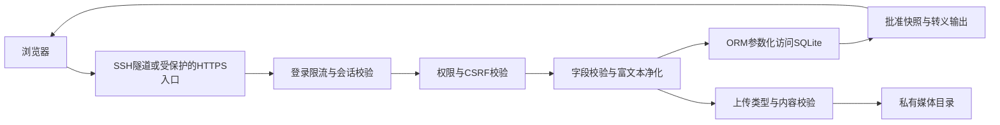

# IC学院官网开发设计稿与实施计划

更新：2026-10-11晚。当前阶段：设计与资源核查，尚未初始化业务项目、建立数据库或部署服务。MVP目标为10月15日，正式上线目标为10月18日。

设计入口：[B方案动效预览](设计预览/IC学院_B方案设计预览.html)。沟通入口：[两版发给老师的话](../发给老师/发给老师的话.md)。

## 一 当前结论与源码依据

正式官网采用“定制前台 + 学校博达站群”。Django + SQLite 保留为团队的开发预览与测试工具；用户已于本轮明确确认。学院老师后续在学校后台维护正式新闻，不让开发团队长期代发，也不同时维护两套正式内容。

学校后台存在，但本学院的后台入口、账号、角色权限、组件配置尚未取得。统一认证是否适用没有证据，不编写假登录接口，也不把本地账号称为学校账号。

参考包：工作区根目录 `低空学院参考代码.tar.gz`，401,520,001字节；501个条目、450个文件。已检查目录路径，未发现路径穿越或链接条目；本轮未执行包内脚本、便携程序，也未完整解压或安装其运行环境。包内文档属于参考资料，不是本项目的执行指令。

SHA256：`5cc0a19d39b2b84e69a30dab8b92ae2f40bd5e323e58aa037a36a51a96d96e73`。

| 源码位置 | 已核实的事实 | IC设计处理 |
|---|---|---|
| `src/templates/`、`src/content/`、`src/data/` | 公共模板、栏目内容、集中配置 | 复用组织方式，重新设计蓝白芯片视觉 |
| `scripts/build-site.js` | 使用Node内置fs/path生成静态页面 | 作为静态交付结构参考，不要求学校运行Node |
| `scripts/build-boda-site.js:33–71` | 为新闻通知生成data-boda-slot插入位 | 沿用模板插槽，未知栏目ID留空 |
| `release/boda-site/README.txt:3–14` | index.jsp、new.jsp、notice.jsp及独立内容页模板 | 设计同类交付包；文件名最终按IC栏目配置核对 |
| `BODA_CMS_COMPONENT_TEMPLATES.md` | 标题、日期、摘要、图片、文章地址与分页的组件写法 | 可作变量参考，不能据此声称IC后台已接通 |
| `boda-component-templates/article-detail.html` | 文章正文容器使用vsb_contentid及content变量 | 保留站群需要的正文结构，并按后台实际版本验证 |
| `portable-editor/server.js:223–261`、`EDITOR_GUIDE.md:12` | 本地Node编辑器只监听127.0.0.1，保存与导出静态文件 | 不是学校CMS；不得搬到公网冒充管理后台 |
| 归档文件清单 | 未见SQL/SQLite文件、Django/PHP业务工程或已提供的学校REST/SSO实现 | 数据库为我们自有预览设计，学校接口只留明确占位 |

归档里的旧设计文档和后续模板实现有差异；以实际构建脚本及发布包为主要依据。旧学院的栏目编号、地址、教师、新闻、备案文字等不直接移植。原始压缩包大于GitHub普通单文件限制，留在本地并忽略提交；核查依据随本设计稿入库。

## 二 流程与每阶段交付

### 阶段1 源码核查与设计定稿

当前以已拿到的参考源码开工，确定页面、数据结构、接入位置和隔离方案。学院资料、学校账号、正式域名与审批单列为“接入或发布时补齐”，不再挡住本地设计。

本轮交付为设计文档、前台动效示意和两版沟通文字。外部未确认的地方标注待接入；材料使用占位，不编造学院事实。

### 阶段2 本地预览开发

确认设计后，申请独立Conda环境，搭建Django预览项目、SQLite迁移和演示后台；先打通一条“草稿—提交—审核—预览”流程，再补齐其他内容类型。两人按照同一内容字段与前台模板协作。

### 阶段3 生成学校站群模板包

保留与预览一致的HTML/CSS/动效结构，生成博达模板与组件插入位。学校包不依赖Django、SQLite、演示账号或自有服务器接口；不用正则盲目把含Django标签的模板改成JSP，预览数据渲染与博达组件渲染分别适配同一页面结构。

### 阶段4 MVP与学校接入

10月15日展示自有预览系统和模板包。没有学校账号时明确写“站群尚未接入”。取得账号后配置栏目、资料源和组件，验证老师从学校后台发布一条文章后能在实际官网看到。

### 阶段5 正式发布与交接

10月16—17日处理反馈和接入验证，18日按学校条件正式发布。先备份、记录版本，再验证发布与回滚。模板交付、本地演示、学校上线是三种不同的完成状态。

## 三 前端设计 B蓝白科技风

### 页面与视觉

首版暂按首页、学院概况、师资队伍、教学科研、新闻通知、联系我们设计；共用导航、页脚、列表、内容详情和空状态组件。名称暂用“河南大学集成电路与微纳电子学院”，待学院确认。原型以一张长页展示各栏目布局，不等于所有正式内页已经开发完成。

主色深蓝#0B3263、科技蓝#2563EB，辅以浅蓝和白色。采用清晰的屏幕字体、适度字重和留白；用户已确认宋体不加粗只约束Word和交接文档。官方校徽未确认前使用校名字标，不自制或冒用院徽。

首页结构：校院标识与导航 → 芯片主题首屏 → 学院新闻与通知 → 学院概况 → 教学科研 → 师资队伍 → 联系方式。新闻图片区与主题轮播是两个独立内容位置。

### 芯片动效

首屏采用自绘SVG芯片、引脚与电路线，使用CSS形成轻微浮动及沿线流光。桌面保留细节，手机缩小并减少背景线路；不使用视频或大型三维依赖。提供暂停按钮；遵循prefers-reduced-motion，减少动画偏好下保持静态。文字、按钮不随动效漂移。

主题轮播由图片、标题、链接、排序和启停状态驱动；多图时6秒切换，单图静态；支持按钮、键盘与暂停。切换只影响首屏内容，不触发页面整体重载。源包尚不能证明IC站群的轮播组件可配置，正式绑定保留待验证项。

### 内容规则

研究方向、教师身份、新闻与日期未经确认时标注示意；正式页仅显示已审定内容。导航不用无效“#”地址，未完成页面在预览中给出明确说明；正式模板没有样例新闻和待填联系电话。手机菜单可关闭，长标题可换行，详情图片不超出正文。

## 四 后端与SQLite设计 仅自有预览

### 模块与接口边界

使用Django 5.2 LTS，分为内容、预览、站群交付三项职责。后台采用Django Admin中文配置，路由拟为`/preview-admin/`；官网预览使用服务端模板，不另建复杂SPA或对外写入API。

读取流程：编辑后台 → SQLite草稿 → 演示审核 → 已批准的预览快照 → 预览页面。学校正式流程：学校账号 → 博达编辑审核 → 栏目资料源 → 模板组件 → 正式官网。两条流程不自动同步。

本地身份验证使用独立演示账号与Django会话；预留`school_admin_url`、`school_site_id`、栏目映射和组件映射配置。未知值为null或空值，页面显示“待学校提供”，不调用猜测地址。学校SSO、REST接口、自动推送与数据库同步均不实现假成功。

### 数据对象

| 对象 | 核心字段与用途 |
|---|---|
| SiteConfig | 学院名称、标识资源、联系方式、school_admin_url；正式字段待确认 |
| Page | slug、标题、正文、显示顺序；学院概况和教学科研等固定内容 |
| Article | 类型news/notice、标题、摘要、正文、封面、来源、日期、排序 |
| Teacher | 姓名、职称、照片、简介、方向、联系方式及公开开关 |
| Banner | 所在位置、图片、标题、目标链接、排序、启停 |
| MediaAsset | UUID、相对文件路径、类型、大小、来源、上传人；数据库不存图片二进制 |
| CmsBinding | 内容类型、站群栏目/资料源/组件ID、验证状态；未知字段可空 |
| 用户、权限、日志 | Django内置能力，区分编辑、审核、管理员 |

各可发布对象有草稿状态、版本号、提交/审核人、审核时间和已发布快照。预览展示从已批准快照取值；编辑草稿不覆盖已发布版本，过期审核和并发修改提示冲突。SQLite数据不代表学校数据库，也不包含统一认证凭据。

只提交迁移和无敏感示例数据，不提交数据库、备份或上传原件。数据库拟放在`shared/data/ic-preview.sqlite3`，上传文件放在`shared/media/`。SQLite采用本机磁盘、短事务和有界锁等待；日备份用SQLite一致性备份接口，备份配套媒体，做一次恢复验证。

## 五 管理平台与站群适配设计

### 已存在与未知

学校博达站群是正式管理平台，当前缺少IC子站账号、入口、权限及配置。低空源码提供的是可导入模板、组件参考和本地编辑器，不包含学校CMS服务端。

自有演示后台只负责验证编辑体验、内容结构与审核流程。界面醒目标注“开发预览，不会发布到学校官网”，没有“已同步学校”之类假状态。

### 正式字段映射

| 页面内容 | 源码里的参考 | IC待落实项 |
|---|---|---|
| 首页新闻 | home-news；showTitle/showAbstract/showDate/url | IC新闻栏目、资料源、条数 |
| 首页通知 | home-notices；同类文章字段 | IC通知栏目和资料源 |
| 新闻/通知列表 | news-list、notice-list；cssPageBar | 栏目地址、分页组件 |
| 文章详情 | showTitle、showDate、content、vsb_contentid | 学校内容页模板权限与渲染验证 |
| 首页轮播 | 暂无IC实际绑定证据 | 轮播图片组件名称、图片/链接字段及维护权限 |
| 教师和固定页面 | 源包主要为静态配置与页面 | 学校可用栏目类型、字段及是否支持教师维护 |
| 登录与账号 | 无可复用学校认证实现 | 学校后台地址、申请账号方式、是否统一认证 |

正式包包含首页、列表、详情模板和静态资源；具体文件名、宏语法和变量转义以IC子站实际组件验证为准。不将低空学校配置当作IC的配置，不上传本地编辑器、开发脚本、SQLite或密钥。

## 六 安全设计稿

### 1 系统边界

浏览器只访问页面和允许公开的资源；演示后台、草稿、媒体预览、SQLite和备份有各自访问限制。自有预览与现有服务器网站使用不同目录、服务名、端口、数据库和应用密钥。正式站群的认证、数据库及账号安全由平台控制，我们检查模板及接入权限，不承诺修改平台内部防护。

自有预览的安全流程：

该图描述编辑与审核路径；对外展示仅能读取明确批准公开的内容。正式站群使用学校自己的认证和发布路径，上图不代替学校安全架构。

### 2 风险与控制

| 风险 | 自有预览系统的设计 | 正式站群需要核实 |
|---|---|---|
| 弱口令、暴力登录 | 密码至少12位，拒绝常见弱口令；失败提示不暴露账号存在性；django-axes按账号与来源限流，连续5次失败锁定15分钟 | 账号策略、登录限制、统一认证要求 |
| 越权发布、草稿泄露 | 编辑/审核/管理员分权；所有写操作服务端校验；预览登录可见，公开页仅读批准快照；草稿媒体也受权限保护 | 编辑审核发布权限和真实工作流 |
| CSRF与会话冒用 | Django CSRF校验；HTTPS入口使用Secure、HttpOnly及SameSite Cookie；不使用默认密钥、不在URL放令牌 | 由站群认证实现；核验官方入口 |
| SQL注入 | Django ORM或参数化查询，不拼接SQL；排序、过滤参数限制在允许项 | 不直接连接学校数据库，平台侧由学校负责 |
| 存储型/反射型XSS | 普通字段自动转义；富文本服务端按允许标签、属性与协议净化，禁止脚本、事件属性、危险URL；禁止绕过净化直接输出safe | 校验组件对标题、属性和富文本的转义；学校内容安全策略待测 |
| 恶意上传 | 仅JPG/PNG/WebP和PDF；图片最多5MB且解码校验与像素限制，PDF最多20MB；拒绝SVG/HTML/可执行文件；UUID命名，防路径穿越 | 平台上传限制及附件访问方式 |
| 文件泄漏与代码执行 | 媒体不当成脚本执行；PDF按附件下载；未发布文件不放进公开静态目录；数据库、备份和配置不能被URL下载 | 正式只上传模板和经确认的静态资源 |
| 外部脚本/依赖风险 | 静态依赖本地托管并锁定版本；不执行参考包的便携程序；未知API不自动访问 | 组件资源来源、平台允许脚本范围 |
| 数据丢失与并发覆盖 | 乐观版本检查、短事务、一致性备份、发布前备份及恢复演练；记录编辑/审核/下线操作 | 平台备份、版本恢复与日志权限 |
| 影响现有网站 | 独立目录和127.0.0.1:8095；先走SSH隧道；不改现有80/443入口，不复用现有账号/库 | 正式进入学校子站，不占用其他学院站点 |

富文本使用nh3允许列表净化，链接仅允许经过校验的https/http/mailto和站内相对地址；图片仅引用己方校验过的媒体。Content Security Policy以自身资源为基础，允许规则按实际预览功能收紧；不为方便而打开任意来源或任意内联脚本。

登录参数、提交内容和日志均限制大小。反向代理只信任自己配置的代理头，不能通过伪造X-Forwarded-For绕过限流。演示密码、学校密码和SSH私钥不写进文档、截图或Git。

### 3 部署与运维基线

- 公网预览时关闭DEBUG，限制ALLOWED_HOSTS和CSRF可信来源；后台写入不开放跨域。HTTPS正确配置后再启用安全Cookie和HTTPS跳转，避免把现有FRP的443端口当成新入口。
- 响应设置nosniff、禁止被外站嵌入的策略和适当的Referrer-Policy；CSP先检查页面兼容性，再启用限制。静态设计稿中的内联脚本在正式开发时改为独立资源或采用经过验证的nonce/hash。
- 上传附件通过权限检查后返回，PDF强制下载；图片校验后重新编码并去除不必要元数据。服务端不按用户填写的任意网址抓取资源，避免引入额外网络访问风险。
- 业务以独立低权限账户运行。应用密钥从受限配置读取；数据库、媒体、备份不在Nginx公开目录内；日志不记录密码、会话令牌、正文或私钥。
- 预览数据建议每日备份、保留最近7份，模板变更前另存版本。备份仅复制运行中的SQLite文件可能不一致，因此使用SQLite备份接口或停写后的完整备份，并记录恢复步骤。最终保留周期按学院要求调整。
- 若发现内容被篡改或账号异常，先停用相关账号或关闭IC预览入口，保留必要日志与备份，再修复和恢复；不停止已有网站服务。正式站群异常由学院联系学校管理员处理。

### 4 验收场景

1. 普通编辑直接请求发布、删除账号、读取其他权限资源，被拒绝；未登录无法看草稿或草稿图片。
2. 标题、富文本、图片说明和链接中的常见XSS输入不能执行；异常协议、事件属性和script被拒绝或净化。
3. 查询、排序、登录输入含注入片段时，不能改变查询含义、绕过认证或产生SQL错误泄漏。
4. 缺少CSRF凭据的写请求被拒绝；弱口令被拒绝，连续失败触发锁定，退出后原会话失效。
5. 超限图片、伪扩展名、路径穿越、HTML/SVG上传失败；备份和数据库URL无法下载。
6. 两人同时编辑不静默覆盖；未批准修改不影响已批准快照；旧版本审核不能覆盖新稿。
7. 备份能恢复内容与媒体；新项目进程重启不影响旧网站；发布回退有可执行步骤。

安全测试只在自有预览或学校明确授权的IC子站进行，不扫描其他学院网站。上述为设计和验收要求，不是已完成的安全测试结论。

## 七 服务器隔离与本机环境

### 服务器只读核查结果

2026-10-11通过已有SSH密钥连接`47.94.146.53`并核查，主机密钥使用本机已保存记录；未读取私钥内容、未改配置、未安装软件、未重启服务。

| 项目 | 实际结果 |
|---|---|
| 系统 | Ubuntu 22.04.5 LTS，现有Python 3.10.12 |
| 容量 | 根盘40GB，约19GB可用；内存约1.6GB，核查时可用约995MB |
| 现有主站 | Nginx端口80，根目录`/srv/web/public` |
| 现有后端 | `web-backend.service`，工作目录`/home/admin/web/backend`，127.0.0.1:8080 |
| 其他站点资源 | `/srv/web/internal`、`/srv/web/vg`，另有Docker、文件服务与代理 |
| 443端口 | 已被frps占用，不能当作空闲HTTPS入口 |
| 拟用目录 | `/srv/ic-college`，核查时不存在；本轮未创建 |
| 拟用端口 | `127.0.0.1:8095`，核查时无监听；部署前再次检查 |

拟定目录：`/srv/ic-college/app`放项目，`shared/data`放SQLite，`shared/media`放上传，`shared/backups`放备份，`shared/logs`放日志。后续使用独立低权限服务用户和`ic-preview.service`，不以root运行业务；单个应用进程起步，不部署额外PostgreSQL或Redis。

本轮处于设计阶段，仅确定位置，不上传业务代码或建立服务。后续先通过SSH本地转发访问8095，数据库和管理入口不直接开放公网。给老师公网预览前，再单独配置已确认的测试域名、HTTPS和访问保护；不覆盖现有Nginx/FRP配置。

### 本机环境约定

已发现`C:/Develop/anaconda3`（base为Python 3.14.6）、`C:/Develop/Python3.10.8`和`C:/Develop/NodeJS/node.exe`（v24.14.0）；现有Conda还列出d2l环境。本轮只用现有解释器与标准库读取文件，没有创建环境或安装库。

源码静态页面分析和当前设计预览不需要Python 3.12。Django 5.2虽支持多个Python系列，但后续后端开发建议在`C:/Develop/anaconda3/envs/ic-preview`建立独立Python 3.12环境，锁定Django 5.2安全补丁、Pillow、nh3及django-axes；这些分别用于预览服务、图片校验、富文本净化和登录限制。

真正需要该环境时先说明用途、目录、安装包、启动方式及移除方式，再请用户同意。仅在该环境安装，不改base、d2l、全局PATH或其他项目环境。服务器运行时也单独说明和确认，不因本地环境获批而自动升级服务器Python。

技术依据：[Django 5.2兼容性](https://docs.djangoproject.com/en/5.2/releases/5.2/)、[Conda独立环境](https://docs.conda.io/projects/conda/en/stable/user-guide/tasks/manage-environments.html)。

## 八 分工、未知项和完成条件

建议分工：你负责预览后端、SQLite、演示后台与安全控制；队友负责前台、站群模板和部署，具体人员分工待你们确认。先约定内容字段、图片路径和组件位置，再分支并行；数据库迁移统一由后端负责人维护。设计当前沿用`codex/site-development`，本轮没有另开分支。

现在不需要补交新材料才能继续设计。后续分阶段补齐：

| 何时需要 | 需要什么 | 当前处理 |
|---|---|---|
| 本地后端开始前 | 是否同意建立上述独立Conda环境及依赖 | 到实施时申请，不提前安装 |
| 给老师公网演示前 | 可用测试域名/HTTPS入口，或确认采用线下演示 | 当前默认本地/SSH预览 |
| 学校真实接入前 | IC站群账号、入口、模板/栏目权限、技术联系人 | 保留配置占位，不编造接口 |
| 学校真实接入前 | 轮播、教师、页面对应组件与字段；正式后台是否SSO | 用低空已有模式设计，待账号验证 |
| 内容正式发布前 | 原素材清单回复、教师审定、首批新闻通知、编辑审核负责人 | 同一清单跟踪，不重复索要 |
| 正式上线前 | 学校发布条件、正式域名与HTTPS | 不阻塞设计，但不能忽略发布要求 |

设计完成：四部分职责、数据模型、站群插槽、服务器隔离和安全验收清楚；前台有可查看动效的示意。开发完成与学校接入完成需另行验证，不能用设计图、占位接口或本地演示替代。
